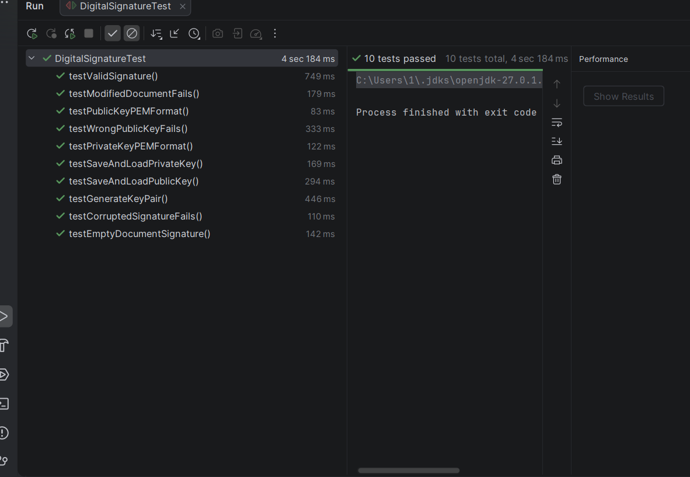

# Электрондық қолтаңба утилитасы (RSA-2048 & SHA256withRSA)

**Орындаған:** Батырова Эджебай  
**Пән:** Ақпараттық қауіпсіздік / Java криптографиясы (№11 жоба)

## Жобаның мақсаты
Бұл утилита стандартты Java Cryptography Architecture (JCA) құралдарын пайдалана отырып **RSA-2048** асимметриялық кілт жұбын генерациялауға, кілттерді **PEM** форматында сақтауға және оқуға, сондай-ақ электрондық құжаттарға **SHA256withRSA** алгоритмімен цифрлық қолтаңба қойып, олардың түпнұсқалығын тексеруге арналған.

## Орнату және іске қосу

1. **Репозиторийді клондау:**
   ```bash
git clone https://github.com/ejebaybatyrowa05/DigitalSignature.git
   cd DigitalSignature
   ```

2. **JUnit 5 тестілерін іске қосу (10 тест):**
   ```bash
   mvn test
   ```

3. **Бағдарламаны іске қосу:**
   ```bash
   mvn compile exec:java -Dexec.mainClass="DigitalSignature"
   ```

## Қолдану мысалы және нәтижесі
Бағдарлама іске қосылғанда `public_key.pem` және `private_key.pem` кілттерін жасайды, енгізілген құжатты (`document.txt`) жабық кілтпен растап `signature.sig` файлын құрады және құжат өзгертілген жағдайда қолтаңбаның жарамсыз (`false`) болатынын тексереді.


## Қауіпсіздік ескертпесі
* **Құпия кілт (`private_key.pem`):** Ешқашан ашық репозиторийге (GitHub) жүктелмеуі тиіс. Бұл жобада барлық `.pem` және `.sig` файлдары `.gitignore` арқылы бұғатталған.
* **Стандартты криптография:** Өз алгоритміміз ойлап табылмаған, тек ресми `java.security` (`KeyPairGenerator`, `Signature`, `KeyFactory`) кластары қолданылған.
  
